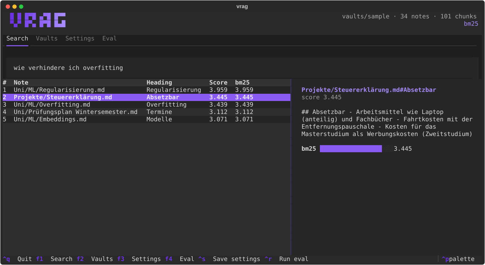
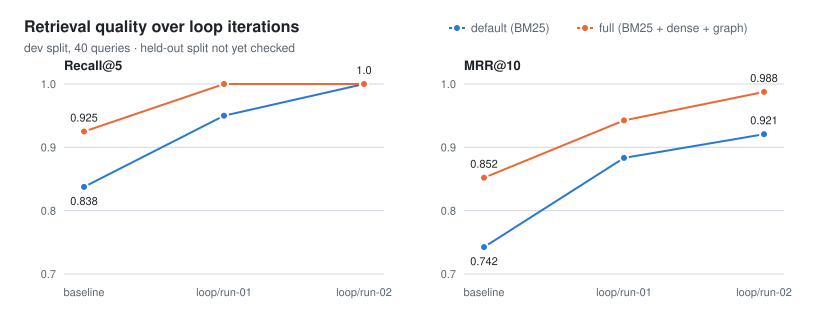

# vrag

```
█ █ █▀█ ▄▀█ █▀▀
▀▄▀ █▀▄ █▀█ █▄█
```

**Local-first retrieval for Obsidian vaults.** No cloud, no API keys. Your notes never leave your machine.

- **Retrieval that's measured, not guessed.** Every pipeline change is scored against an eval set, and the pipeline is tuned by a self-improving agent loop ([`LOOP.md`](LOOP.md)).
- **Terminal UI.** Live search with a per-stage score breakdown, vault management, every setting editable.
- **For agents too.** `vrag mcp` exposes your vault to Claude Code, Cursor & co. as read-only MCP tools.

One engine, three surfaces: TUI for humans, CLI with `--json` for scripts, MCP server for agents.

## Install
```bash
pip install vrag-obsidian        # or: uv tool install vrag-obsidian
uvx --from vrag-obsidian vrag --help   # run without installing
```
The PyPI name is `vrag-obsidian` (`vrag` was taken); the command and the import package are `vrag`. Python 3.11+.

## Quickstart
```bash
vrag --vault ~/Notes search "wie verhindere ich overfitting"
vrag --vault ~/Notes search "fahrradkette ölen" --json -k 3
vrag --vault ~/Notes tui
```
Without a `config.toml` in the working directory vrag uses the built-in defaults, which match the
[`config.toml`](config.toml) in this repo. Pass `--config path/to/config.toml` to change them.

From a clone (needed for `vrag eval`, which uses the eval set and sample vault in the repo):
```bash
uv sync
uv run vrag --vault vaults/sample search "wie verhindere ich overfitting"
uv run vrag eval          # dev split → eval/results/latest.json
uv run pytest -q
```

## Pipeline
```
notes ─> chunks by heading ─┬─> BM25: stopwords, compound splitting, stemming, acronyms
                            └─> dense: Ollama bge-m3, cached in sqlite-vec          (optional)
                                       │
                                       ▼
                              weighted RRF at note level
                                       ▼
                              wikilink neighbour boost                               (optional)
                                       ▼
                              cross-encoder rerank of the top_n                      (optional)
                                       ▼
                              note-level hits with per-stage scores
```
Every stage is a toggle in `config.toml`. Only BM25 is on by default, so the defaults need nothing but Python.
Results are note-level and deduplicated; each hit carries its score per stage, so you can see why it ranked where it did.

### Dense retrieval (optional)
Dense search embeds chunks with [Ollama](https://ollama.com) and fuses them with BM25 via note-level RRF.
```bash
ollama pull bge-m3
# config.toml → [dense] enabled = true
```
Embeddings are cached in `.vrag/embeddings.sqlite` (sqlite-vec), so only new or changed chunks get embedded on re-index. If Ollama or the model is missing, vrag prints a warning and falls back to BM25.

### Wikilink graph (optional)
`[graph] enabled = true` lifts notes that are one `[[wikilink]]` away from strong hits. It is off by default: on dev it is neutral at small boosts and hurts hybrid MRR at larger ones.

### Reranking (optional)
A cross-encoder ([`bge-reranker-v2-m3`](https://huggingface.co/BAAI/bge-reranker-v2-m3)) rescores the top `top_n` notes of the first stage; a note counts with its best chunk.
```bash
pip install "vrag-obsidian[rerank]"   # from a clone: uv sync --extra rerank (sentence-transformers + torch, large)
# config.toml → [rerank] enabled = true
```
The model is downloaded from Hugging Face on first use. Without the extra or the model, vrag prints a warning and keeps the first-stage ranking.

## Terminal UI



| Tab | Key | What it does |
|---|---|---|
| Search | `F1` | Live search as you type; results table plus a per-stage score breakdown (BM25 / dense / graph / rerank, whichever are on) for the highlighted hit. `Esc` jumps back to the search box. |
| Vaults | `F2` | Add a vault by path, `Enter` on a row opens it, *Remove* drops it. Remembered in `.vrag/vaults.json`. |
| Settings | `F3` | Every `config.toml` option as a form; `Ctrl+S` saves and re-indexes. Only the changed values are rewritten, comments and layout stay. |
| Eval | `F4` | `Ctrl+R` scores the dev split on the sample vault (from a clone); history with deltas lives in `.vrag/eval_history.jsonl`. |

`Ctrl+Q` quits. On macOS, F1–F4 may be media keys; use `fn` + F-key or turn on standard function keys.
More screenshots: [Eval](docs/tui-eval.svg) · [Settings](docs/tui-settings.svg). Regenerate with `uv run python scripts/screenshots.py`.

## Use it from Claude Code (MCP)
`vrag mcp` is a read-only [MCP](https://modelcontextprotocol.io) server over stdio. Register it once:
```bash
claude mcp add vrag -- uvx --from vrag-obsidian vrag mcp --vault /path/to/your/vault
# from a clone instead:
claude mcp add vrag -- uv run --directory /path/to/vrag vrag mcp --vault /path/to/your/vault
```
Use absolute paths, also for `--config` if you pass one: the server's working directory is not your shell's.
Repeat `--vault [NAME=]PATH` to expose several vaults. Then run `/mcp` in Claude Code to check that `vrag` is connected.

| Tool | What it does |
|---|---|
| `search_vault(query, k?, vault?)` | note-level hits with heading, snippet, per-stage scores |
| `read_note(note, vault?)` | full markdown body, frontmatter, tags, outgoing links |
| `related_notes(note, vault?)` | `[[wikilink]]` neighbours: outgoing, backlink or both |
| `list_vaults()` | exposed vaults and note counts |

`note` is a vault-relative path (`Kochen/Shakshuka.md`) or a note title. The server can't write anything,
and it only returns notes it indexed inside the vault. Absolute paths, `..`, symlinks that point
outside the vault and `.obsidian/` are all refused.

## Retrieval quality

<picture>
  <source media="(prefers-color-scheme: dark)" srcset="https://raw.githubusercontent.com/jonez-x/vrag/main/docs/recall-dark.svg">
  <source media="(prefers-color-scheme: light)" srcset="https://raw.githubusercontent.com/jonez-x/vrag/main/docs/recall-light.svg">
  
</picture>

> **Read these numbers with care.** All scores are on the **dev split: 40 queries** over the
> small sample vault in [`vaults/sample/`](vaults/sample). The loop tuned the pipeline on exactly these queries, so
> overfitting is likely. The **held-out split has not been checked yet**; a human still has to run it before
> these numbers mean anything beyond this vault.

| Version | Pipeline | Recall@5 (dev) | MRR@10 (dev) |
|---|---|---|---|
| baseline | BM25, heading chunks | 0.838 | 0.742 |
| `feat/dense` | dense only (`bge-m3`) | 1.000 | 0.967 |
| `feat/dense` | hybrid BM25 + dense, note-level RRF (k=60) | 0.925 | 0.852 |
| `loop/run-01` | BM25 + stemming/stopwords | 0.950 | 0.883 |
| `loop/run-01` + `feat/dense` | hybrid BM25 + dense | 1.000 | 0.943 |
| `feat/graph` | hybrid + graph, boost 0.05 | 1.000 | 0.943 |
| `feat/rerank` | BM25 + rerank, top_n 10 / 20 / 30 | 0.950 | 0.913 |
| `feat/rerank` | hybrid + rerank, top_n 10 / 20 / 30 | 1.000 | 0.950 |
| **`loop/run-02`** | **BM25 + stopwords, compound splitting, acronyms, k1 1.2 (default)** | **1.000** | **0.921** |
| **`loop/run-02`** | **hybrid + graph 0.05, dense RRF weight 1.2 ("full")** | **1.000** | **0.988** |

Latency per query on an Apple-silicon Mac, model already loaded: BM25 < 1 ms, hybrid ~23 ms.
Reranking adds ~270 ms on BM25 and 0.6–1.5 s on hybrid, which is too slow for live TUI search.
Full per-PR history, including what didn't work: [`PROGRESS.md`](PROGRESS.md), [`experiments.md`](experiments.md).
Regenerate the chart with `python scripts/recall_chart.py`.

## How the loop works
```
┌─> agent changes ONE thing (chunking, stemming, fusion, …)
│        ↓
│   vrag eval  →  Recall@5, MRR
│        ↓
│   better? → commit + log   ·   worse? → revert + log
└────────┘
```
The eval set and the test vault are write-protected for the agent by a Claude Code hook, and the held-out split,
which the agent never sees, is there to catch overfitting.

## Releasing
Versions live in `src/vrag/__init__.py`; changes go into [`CHANGELOG.md`](CHANGELOG.md).
Pushing a tag `vX.Y.Z` that matches `__version__` runs [`publish.yml`](.github/workflows/publish.yml): tests, build,
wheel smoke test, then upload to PyPI via [Trusted Publishing](https://docs.pypi.org/trusted-publishers/) (no API token).

One-time setup, before the first tag:
1. On pypi.org → *Your account* → *Publishing* → *Add a new pending publisher*: project `vrag-obsidian`,
   owner `jonez-x`, repository `vrag`, workflow `publish.yml`, environment `pypi`.
2. On GitHub → *Settings* → *Environments* → create `pypi` (optionally with required reviewers).

Check a build locally with `uv build` and `uv run --isolated --no-project --with dist/*.whl vrag --version`.

## License
MIT
